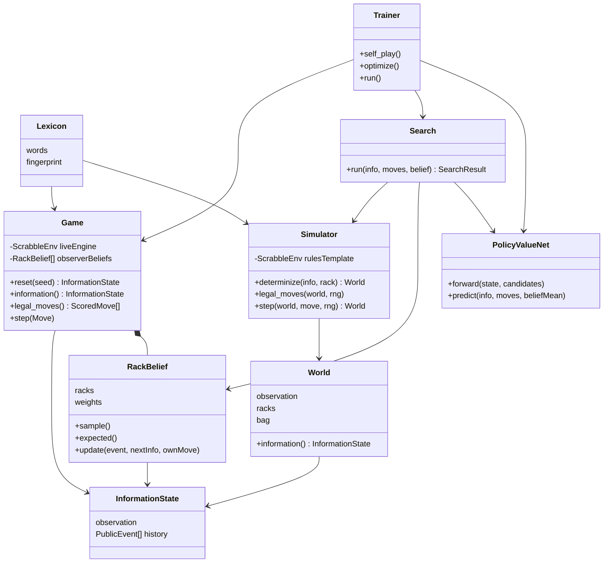

# RackZero: information-safe Scrabble self-play

RackZero adds a Python/PyTorch learning pipeline alongside, not in place of,
the existing browser, Java, Gymnasium, DQN and Quackle workflows.
It is a runnable research baseline, **not a tournament-strength model or an
exact solution to imperfect-information Scrabble**.

## Install

From the repository root, install **Python 3.10+ and JDK 17+**. Java must be
discoverable on `PATH` or through `JAVA_HOME`; Maven is optional.
Windows PowerShell:

```powershell
python -m venv .venv
.\.venv\Scripts\Activate.ps1
python -m pip install -e ".[learning]"
python -m scrabble_gym.build
python train.py --config configs\smoke.yaml --run-dir runs\smoke
python evaluate.py --checkpoint runs\smoke --games 4 --opponents greedy random
```

Activation is optional: substitute `.\.venv\Scripts\python.exe` for `python`.
On other platforms activate the virtual environment using the platform's
normal mechanism. Run entry points from the repository root; configuration
paths are relative to the **working directory**, not the configuration file.

For CUDA, install an appropriate CUDA-enabled PyTorch build using the
[official PyTorch selector](https://pytorch.org/get-started/locally/) before
installing the learning extra. Then use `configs\gpu.yaml`. Requesting CUDA
when unavailable is an error, never a silent CPU fallback (`runtime.device:
auto` picks CUDA only when present). The CUDA path (bf16 training, GPU
evaluation, batched inference server, CUDA RNG checkpoints) has been run on
an RTX 4070 Laptop GPU. For the NCSA Delta A100 workflow see
[A100_TRAINING.md](A100_TRAINING.md).

## Dictionary setup and licensing

Smoke training uses an original, small real-English test vocabulary built into
`TinyLexicon`. This tests plumbing, not tournament play. All other supplied
configurations expect a **user-supplied** `WOW24v3.zip` in the repository root.
It is ignored by Git and is not redistributed with RackZero.

Obtain WOW24 from [WGPO's official page](https://wordgameplayers.org/wgpo-official-words/).
The locally supplied WOW24v3 archive identifies WGPO as its source and says
WOW24 may be used and shared freely **as long as it is not for profit**.
That is not an unrestricted open-source/commercial license. Review the
specific download's terms and obtain permission for uses outside those terms.
RackZero's MIT license does not relicense lexicons or their data.

The official page also provides a plain-text full alphabetical lexicon.
Download that file locally, then set, for example, `dictionary: words-wow24.txt`
in your configuration. Plain uppercase/lowercase ASCII word files and
single-text-file ZIPs containing WGPO tab-separated hook tables are accepted;
only the word column is used. Entries must have 2..15 letters. Invalid
lexicons are rejected, not silently replaced with a demo lexicon.

`Lexicon` is a protocol; `WordLexicon`, `FileLexicon` and `TinyLexicon` implement
it. Supply a backend's `.words` to `Game`/`Simulator`. The engine builds a trie
and uses exact set membership, independent of where the lexicon came from.
Sorted word content has a SHA-256 fingerprint, recorded in every checkpoint
and checked on evaluation/resume.

## Train, resume, evaluate

Configurations are nested YAML files (`configs/`). A file may `extends:`
another, and any key can be overridden with `--set section.key=value`.
Unknown keys are errors. Each new run gets its own directory
`<output_root>/<name>-<timestamp>/` (or `--run-dir`) containing
`config.yaml` (fully resolved), `environment.json` (versions, GPU, git
commit, Slurm job), `metrics.jsonl`, `metrics.csv`, `checkpoints/`
(`latest.pt` with replay, `best.pt`, `iteration_NNNN.pt`) and the worker model
files in `models/`.

| Config | Purpose |
|---|---|
| `smoke.yaml` | tiny lexicon and network, CPU; whole loop in ~15 s |
| `small.yaml` | first full-dictionary experiments |
| `medium.yaml` | main development baseline (0.8M-parameter ResNet) |
| `large.yaml` | 4.3M-parameter network for A100 runs |
| `cpu.yaml` | CPU debugging (small + 4 workers) |
| `gpu.yaml` | medium on one A100: bf16 training, 15 CPU self-play workers |
| `default.yaml` | the **original** flat schema-1 configuration, kept unchanged; it loads as the `legacy_mlp` baseline |

```powershell
python train.py --config configs\medium.yaml --set selfplay.workers=8
python train.py --config configs\gpu.yaml --set search.simulations=64 --set name=sims64
python train.py --config configs\medium.yaml --print-config      # resolved config, no run

# Resume (the run directory holds its own config); extend with --set
python train.py --resume runs\medium-20261124-101500 --set iterations=80

# Evaluate the best model against several baselines with 95% intervals
python evaluate.py --checkpoint runs\medium-20261124-101500 --opponents greedy heuristic random --games 200 --workers 8

# Head-to-head against an earlier checkpoint, or against a different search budget
python evaluate.py --checkpoint runs\b --opponent search --opponent-checkpoint runs\a\checkpoints\best.pt --games 200
python evaluate.py --checkpoint runs\b --opponent search --opponent-set simulations=8 --games 200

# Compare search methods under identical seeds/seats/config
python evaluate.py --checkpoint runs\b --compare-methods pimc ismcts belief --games 100 --workers 8

# Compare finished runs; profile this machine
python scripts\compare_runs.py runs\*
python scripts\benchmark.py all --output runs\benchmark.jsonl
python scripts\verify_movegen.py --dictionary WOW24v3.zip --games 4
```

**Only load trusted checkpoints.** Full recovery uses
`torch.load(weights_only=False)` and Python pickle, which can execute code.
Worker model files inside a run use `weights_only=True`.

Each iteration:

1. **Self-play.** `selfplay.games_per_iteration` games with neural-guided
   search, in `selfplay.workers` parallel processes (0 = in the trainer). Each
   game's seed is derived from (seed, iteration, game index), so the replay
   buffer is **bit-identical for any worker count** (tested). Moves are sampled
   from visit counts at `selfplay.temperature`, optionally dropping to
   `final_temperature` after `temperature_moves` plies.
2. **Replay.** A fixed-capacity ring of compact, observation-only records:
   board, own rack, unseen counts, belief summary, public scalars, up to
   `search.candidates` legal candidates, visit-count policy target, terminal
   win sign and score margin. Truncated games produce no targets.
3. **Training.** The number of steps is either fixed
   (`training.steps_per_iteration`) or derived from the new data
   (`training.samples_per_position`, default 8 in the new configs). In the
   second case each generated position is sampled about that many times over
   its life in the buffer, whatever the self-play throughput. Minibatches are
   drawn uniformly with replacement. Loss
   `w_p·CE(policy) + w_v·value + w_m·MSE(margin/margin_scale)`. Optimizer is
   Adam, AdamW or SGD; LR schedule constant, cosine or step with warmup;
   gradient clipping; bf16/fp16 autocast on CUDA. Losses accumulate on the
   device, with one host sync per iteration.
4. **Arena** (`arena.mode`): `gate` promotes the candidate only if it reaches
   `threshold` (or its Wilson lower bound exceeds it). Otherwise the weights
   **and optimizer state** roll back together, as in the original trainer. The
   LR schedule keeps advancing. `monitor` always accepts and reports
   candidate-vs-previous every `arena.every` iterations. `off` skips the arena.
5. **Baselines** every `evaluation.every` iterations on a fixed seed schedule
   (`evaluation.seed`), so results are comparable across iterations and
   experiments. Baselines never decide promotion.
6. **Checkpoints.** Atomic `latest.pt` (complete: model, best model,
   optimizer, LR scheduler, AMP scaler, replay, counters, history,
   configuration, lexicon fingerprint and Python/NumPy/PyTorch/CUDA RNG
   states). `best.pt` and `iteration_NNNN.pt` omit replay unless
   `checkpoint.archive_replay`.

Resume continues from the **last completed iteration**; an interrupted
iteration is regenerated from its boundary state. With identical settings a
resumed run reproduces the uninterrupted run exactly (tested). Settings are
classified on resume:

* **neutral**, changeable freely: `iterations`, `selfplay.workers`,
  `selfplay.worker_threads`, `runtime.threads`, `evaluation.*`,
  `checkpoint.*`, `logging.*`, `name`/`output_root`;
* **numerics**, allowed with a warning: device, precision, TF32,
  determinism, inference mode;
* **trajectory**, refused unless `--allow-config-change`: everything else,
  e.g. the learning rate or search budget. The change is recorded in that
  iteration's metrics as `config_changes`.

A checkpoint without replay cannot be resumed. Schema-1 checkpoints (the
original trainer) can still be **evaluated** (`legacy_mlp`), but not resumed,
because their replay stored pre-encoded float features.

`max_turns` is a safety cutoff, not a game rule. Truncated self-play games
produce **no training targets**. Evaluation discards an entire seed/seat pair
if either game truncates. Both paths fail explicitly if no natural outcomes
remain. Monitor the truncation counts.

## Representations and interfaces



Source layout:

| Directory | Responsibility |
|---|---|
| `python/rackzero/game/` | Live-game coordinator, public events, information states, sampled worlds |
| `python/rackzero/dictionary/` | Interchangeable lexicons and content fingerprints |
| `python/rackzero/belief/` | Conservation, hypergeometric draws, weighted rack particles, likelihood hook |
| `python/rackzero/search/` | Shared modular search, five comparison methods, chance nodes |
| `python/rackzero/models/` | Original MLP and configurable ResNet/CNN networks, search evaluator |
| `python/rackzero/features.py` | Compact observation-only records and belief summaries |
| `python/rackzero/replay.py` | Fixed-capacity replay ring |
| `python/rackzero/workers.py` | Parallel self-play/evaluation workers, batched inference server |
| `python/rackzero/config.py` | Nested validated configuration, `extends`, overrides, migration |
| `python/rackzero/checkpoints.py` | Atomic checkpoints, RNG capture, model files |
| `python/rackzero/telemetry.py` | JSONL/CSV/TensorBoard metrics, GPU/CPU sampling |
| `python/rackzero/training/` | AlphaZero loop, batched optimizer, promotion, resume, CLI |
| `python/rackzero/agents/` | Random, greedy, rack-leave heuristic, neural-only agents |
| `python/rackzero/evaluation/` | Paired-seed/swapped-seat tournaments and metrics |
| `configs/` | smoke, small, medium, large, cpu, gpu (+ original `default.yaml`) |
| `scripts/` | benchmark, move-generation verification, run comparison, Delta job scripts |
| `tests/python/test_rackzero*.py` | Core, leakage, chance, training and resume checks |

### Rules and actions

The **existing Java engine remains the single rules/scoring authority** for
live games and for every simulator transition (`playMove`/exchange/pass).
The existing Gymnasium adapter enumerates legal placements using a trie,
anchors and perpendicular cross-checks, then validates/scores them through Java.
It enumerates exchange multisets and pass as well.

Inside search only, `Simulator` replaces the per-candidate Java `preview` call
with `score_placement`, a pure-Python mirror of `Board.scoreWord` (premiums under
new tiles only, blanks zero, cross words, 50-point bingo) using premiums read from
the Java `Board`. Per-candidate JNI round-trips dominated search time (~13x
slower). `test_simulator_python_scoring_matches_java_preview` asserts exact
candidate/score set equality with the live Java path; a WOW24 check over 151
greedy-game positions (101,012 candidates) also matched exactly.

An action is a complete main word, origin, direction and newly placed blank
offsets, an exchange multiset, or pass. Assigned blanks score zero; existing
premiums are not reused. Standard 100-tile English distribution, 15x15 premium
board, seven-tile racks, 50-point bingos, refill, draw-before-return exchange
(requiring at least seven bag tiles), six scoreless turns, going out and final
rack adjustments all use the existing rules. Challenge/timer/tournament dispute
procedures are outside this two-player validated-word environment.

The only new Java API is `ScrabbleGame.fromSnapshot`: it builds a fresh
**hypothetical** game with explicitly supplied tiles, scores and counters.
It never copies a live game's opponent rack or RNG. Each simulator transition
reshuffles the supplied hypothetical bag using its supplied seed; independent
uniform draws without replacement have the same transition law as a uniformly
shuffled bag. No reflection or hidden live-state cloning is used.

### Information boundary and beliefs

`Game` alone owns the actual live state. An `InformationState` contains the
public board/blank assignments, scores, acting seat, bag size, scoreless/turn
counters, opponent rack **size**, and **only the observer's own rack**.
Arrays are copied/read-only. Unexpected observation fields are rejected.
Public placement events retain the public move, played tile counts and score.
Exchange identities are **not** put in public history, only exchange count.

The two observer filters are updated separately with independent random streams,
so one player's private filter work cannot advance the other's sampler.
Internally the coordinator
constructs each observer's view; a player never receives the other view.
`Search` accepts an information state and a lexicon-only `Simulator`, not `Game`.
Policy/value code receives no `World`, live engine, actual bag or opponent rack.
Ground-truth terminal score differences are allowed as learning targets.

Unseen tiles = initial distribution - board tiles (counting blanks as blanks)
- own rack. Uniform opponent racks are sampled without replacement. If the
bag is empty, the unseen multiset **is exactly the opponent rack**.

`RackBelief` is each observer's posterior over the opponent's rack, updated
after every public turn (the filter is described below). Systematic choice
behavior is modeled only when an opponent likelihood is provided. The default
assumes the tiles an opponent plays are a uniform subset of its rack: an
uninformative feasible-action model, not a rational-opponent posterior.

**Exchanged tiles return to the bag.** The Java engine draws replacements
*before* returning the exchanged tiles. After an own exchange, the returned
tiles X become unseen again, but they were in the bag, not in the opponent's
rack, when the opponent last drew. The draw-likelihood step keeps every
particle within `unseen_after - X`, so the filter represents this asymmetry
exactly. (A uniform-over-unseen prior would wrongly let X sit on the opponent's
rack; the tests check this.) Exchanged tiles reach the opponent only through
its later draws. An opponent's exchange reveals only its count.

**Rao-Blackwellized filter (exact under the default opponent model).** Each
particle is a list of groups `(tiles, m)`: the opponent holds a uniformly
random `m`-subset of the physical tiles `tiles`, and the rest of the group is
in the bag. The prior is one group (all unseen tiles, `m` = opponent rack
size). Every public transition keeps this form exactly:

* **Own draw.** The known private draw is a uniform subset of the bag
  positions. Its exact likelihood under each particle (multivariate
  hypergeometric over the groups' bag parts) reweights the particle. Which
  group supplied each drawn letter is sampled from its exact posterior, and
  the drawn tiles are removed.
* **Own exchange.** As above, plus the returned tiles form a new `m = 0`
  group. The engine draws before returning, so returned tiles cannot be on the
  opponent's current rack.
* **Opponent placement.** Under the default opponent model (the tiles played
  are a uniform subset of the rack), the played multiset has an exact
  likelihood. The source groups are sampled from their posterior, and the
  replacement draw moves positions from bag to rack within each group.
* **Opponent exchange.** Only the count is public. The returned and drawn
  positions are sampled per group, and nothing about letters is inferred.
* **Pass.** Nothing changes (tested).

No letter of an unknown tile is ever sampled inside the filter. Particle
weights are exact marginal likelihoods of the observations. Each particle
still commits to one sampled attribution of past draws (which group supplied
which tiles), and later evidence can rule out every particle's attribution.
This is ordinary particle degeneracy, and it is rare. In 30 WOW24 games
(1,558 observer updates, 80% heuristic / 20% random play) it caused 3 resets
at 8 particles and none at 32 or 128. Self-play metrics report
`belief_resets`. Resampling happens only when the effective sample size drops
below half. With an optional opponent-action likelihood (below), groups are
resolved to concrete racks and importance-weighted against the default-model
proposal. When the bag is empty every group is fully held, so the posterior is
**exactly** the unseen multiset (tested in real games).

`Game(..., belief_likelihood=...)` or `RackBelief(..., likelihood=...)` accepts
`(observer_info, public_event, hypothetical_rack) -> probability`.
`SoftmaxScorePolicy` is a normalized immediate-score example. A learned model
can implement the same hook, but **no separately trained opponent model is
bundled**. Public history is maintained incrementally; constructing a fresh
`RackBelief(info)` starts a uniform current prior and does not replay history.

When every particle loses support (more likely with an opponent-action
likelihood or a tiny budget), the filter emits an explicit `RuntimeWarning` and resets
to the tile-conserving current prior; past inferential information is lost.
This is an approximate particle-filter recovery, not an exact Bayesian update.
Increase `search.particles` and monitor the warnings for serious experiments.

### Search algorithms and chance

All methods share legal generation, candidate budget, rollout budget, depth,
terminal accounting and evaluation seeds. Candidate pruning retains the
highest immediate-score candidates, pass and the largest exchange. This is
an explicit **search-space approximation**: low-scoring strategic moves and
other exchanges can be excluded. Policy targets cover the retained candidates,
not every possible legal move. Full generation itself is not pruned.

| Method | Hidden-state treatment and continuation |
|---|---|
| `stochastic` | Fresh uniform root worlds, shared root PUCT, sampled chance transitions; continuation nodes keyed by hypothetical full state |
| `pimc` | Up to four fixed uniform root determinizations, equal interleaved rollout budgets, separate trees, aggregate root visits; score-based priors and score-difference leaf heuristic, no neural evaluation |
| `neural_determinization` | Same determinization/tree aggregation with learned priors and learned leaf value |
| `ismcts` | Fresh uniform root worlds; root-player nodes shared by observable state/public history; opponent follows an observation-only policy |
| `belief` | Same information-set planner sampling the persistent weighted posterior; reached-node particles estimate opponent tile means for policy priors |

PUCT uses `Q + c * prior * sqrt(availability) / (1 + visits)`. Each rollout
backs up terminal sign or a depth-limited value in the root player's
perspective; depth-limited leaves call only the value heads (no move
generation). Visit counts produce the self-play policy. Search never reports
a depth limit as a terminal result. With very small rollout budgets some
candidates will not be visited. With `depth: 1` all neural methods reduce to
the same root PUCT (they differ only below the root), and an untrained,
near-constant value head makes visits nearly uniform; method comparisons are
only meaningful with `depth >= 2` and a trained network.

Self-play may mix Dirichlet noise into the root priors
(`search.root_noise_alpha`, `search.root_noise_fraction`). It is off by
default, which keeps the original search behavior bit-identical. Evaluation
always disables it.

**Which hidden-information approach?** Plain perfect-information MCTS on the
true state is not an option: it would read the opponent's rack. Among the
implemented options:

* Per-world determinization (`pimc`, `neural_determinization`) is cheap and
  strong in practice, but it suffers from strategy fusion: it plans as if it
  knew the sampled rack.
* `ismcts` shares root-player statistics across sampled worlds, so its
  decisions depend only on information the player actually has.
* `belief` samples those worlds from the posterior instead of the uniform
  prior. It is the only method that uses inference from earlier draws and
  exchanges, and it is exact once the bag is empty.

`ismcts` stays the default, because it is the original choice and its
information-set semantics match the training targets. The choice between
`ismcts` and `belief` is an empirical question, and the plan schedules it
(SCALING_PLAN.md row 10). The `belief` method recomputes priors at every node
visit, so it costs more inference.

These are **bounded, documented variants**, not literal reproductions of
SO-/MO-ISMCTS or POMCP. Information-set modes optimize only root-player
decisions, and use an observation-only stochastic opponent policy rather than
an omniscient opponent optimizer. This avoids world-specific opponent
optimization but makes planning dependent on the opponent-policy assumption.
There is no equilibrium/convergence guarantee. Determinization and stochastic
full-state continuation baselines deliberately retain the known
**strategy-fusion/non-locality bias**; do not mistake their values for an
implementable perfect-information strategy. None sees the *actual* hidden rack.

Random draw probabilities are multivariate hypergeometric, derived from each
sampled world's remaining tile counts. Java samples draws exactly without
replacement; explicit chance nodes record sampled unordered draws and their
conditional probabilities. Returned exchange tiles are excluded until after
the replacement draw. Sampling is the production choice: enumerating seven-tile
multisets from a full bag is combinatorial. `enumerate_draws` provides exact
small-support enumeration, checked against analytic and empirical probabilities;
it raises if the requested support budget is exceeded. Exact enumeration is
**not** currently a search mode.

### Move generation in search

The live `Game` always generates and scores candidates through the existing
generator with Java `Board.preview` scoring: **the rules authority**. Inside
search, `Simulator` uses `rackzero/game/movegen.py`. It runs the same
algorithm with board-level anchors and cross-checks cached across sampled
worlds, and accumulates scores incrementally. Its output tuple (moves, order
and scores) is identical to the authority's. This is asserted by
`test_fast_movegen_matches_reference_generator`, and on full-dictionary
games by `scripts/verify_movegen.py`. `search.movegen: reference` restores
the original path. On cold boards both take about 31 ms per WOW24 position.
Inside search the board cache makes decisions about 2.2× faster. Move
generation is still ~66% of search time; a compiled generator is the biggest
remaining speedup available.

### Network and labels

Two architectures read the same compact records (`rackzero/models/networks.py`):

* **`resnet` / `cnn`** (new default): a modular Scrabble network.
  * *Board encoder*: 32 planes (26 letters, blank, occupied, DL/TL/DW/TW
    premiums read from the Java `Board`). A 3x3 stem conditioned on the
    context vector feeds `model.blocks` residual (or plain conv) blocks of
    `model.channels`.
  * *Rack encoder*: own tile counts with blanks separate. *Belief encoder*:
    unseen counts, posterior opponent-rack mean and **P(opponent holds ≥1 of
    each tile)** from the particle groups. *Global encoder*: scores and
    difference, bag and rack sizes, counters, phase flags, and the last
    opponent event (score, exchange count, tiles played).
  * *Shared latent*: mean- and max-pooled board features plus the context.
  * *Policy head*: **scores the legal moves supplied by the generator**.
    Board features are pooled over each move's newly placed squares and over
    its whole main word. These are combined with move features (kind, score,
    tiles, bingo, blanks used, spent and leave counts, vowel/consonant
    balance, geometry) and the latent. An optional self-attention layer over
    candidates (`policy_attention_layers`) lets moves be compared with each
    other. Padding is masked to probability zero. The network cannot invent or
    alter a move.
  * *Value heads*: `scalar` (tanh, MSE to the win sign; the original target)
    or `wdl` (3-way cross-entropy), plus normalized final-margin regression.
* **`legacy_mlp`**: the original `PolicyValueNet`, unchanged, fed features
  identical to the original `encode()` (tested to 1e-6). It is the baseline
  architecture.

Sizes (single-thread CPU inference per call): small 0.17–0.20M parameters
(2.7 ms), medium 0.80M (5.5 ms), large 4.3M (19.5 ms), legacy 0.94M (1.3 ms).
All dimensions are configuration (`model.*`).

Targets are unchanged from the original: the search visit distribution over
the shortlisted candidates, the terminal win sign (draw 0) and the final
score margin / 100. Only natural terminal results are used. The immediate
legal-move score is a rules-derived input feature, not a human label.

## Evaluation and verification

Opponents: `random`, `greedy`, `heuristic` (rack-leave heuristic), `neural`
(policy argmax), and `search`. A `search` opponent uses the same network by
default, another checkpoint via `--opponent-checkpoint` (e.g. the previous
best), and/or a different search configuration via `--opponent-set`. Every
seed is played in both seats. Pairs with a truncated game are discarded as a
whole. Evaluation search never uses root noise.

Reports include: retained/attempted games, truncations, wins/draws/losses,
the half-draw win rate with **95% Wilson interval**, the mean score difference
with **95% interval**, mean score, **mean game length**, per-seat win rate and
margin, time per game, and the immediate-score regret proxy (greedy
immediate score minus the selected move's score). The proxy is not strategic
regret. See [SCALING_PLAN.md](SCALING_PLAN.md) for sample sizes.

```powershell
python -m unittest discover -s tests\python -p "test_rackzero*.py" -v
python -m unittest discover -s tests\python -p test_environment.py -v
python -m unittest discover -s tests\python -p test_dqn.py -v
```

The RackZero tests cover:

* tile conservation and exact empty-bag inference (synthetic and real games);
* fast/reference/Java move-generation parity and snapshot transitions;
* exchanges in both directions, pass invariance, and draw-likelihood weighting;
* information boundaries: swapping the live opponent rack leaves records,
  network outputs and search results bit-identical, and search under every
  method runs with the live engine replaced by an object that raises on any
  access;
* legacy-feature equivalence, masking, permutation equivariance, gradients and
  premium layout;
* root-noise and temperature schedules;
* replay ring, LR schedules, configuration merging/migration/validation and
  Wilson intervals;
* atomic saves, gate rollback and monitor mode;
* exact split-vs-uninterrupted resume, resume-change classification and
  replay-less checkpoints;
* truncation exclusion and pair discarding;
* inline-vs-parallel self-play equivalence.

### Verified development smoke run

`configs/smoke.yaml` (CPU, ~15 s) completes one iteration: two natural
self-play games, batched training, a gated arena, a greedy baseline,
checkpoints and JSONL/CSV metrics. Resume (`--resume <run> --set
iterations=2`) and multi-opponent and parallel evaluation also complete. These
are execution checks, not strength benchmarks: the smoke network loses to
greedy. Results of the full-dictionary runs are in
[RACKZERO_REPORT.md](RACKZERO_REPORT.md).

See [the reference review and research sources](ALPHAZERO_REFERENCE.md) for
what is reused from AlphaZero General and what is deliberately redesigned.
